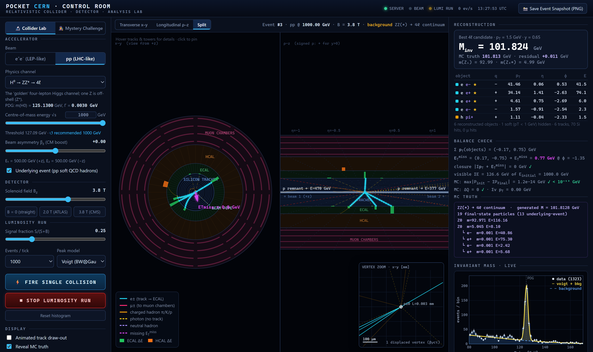
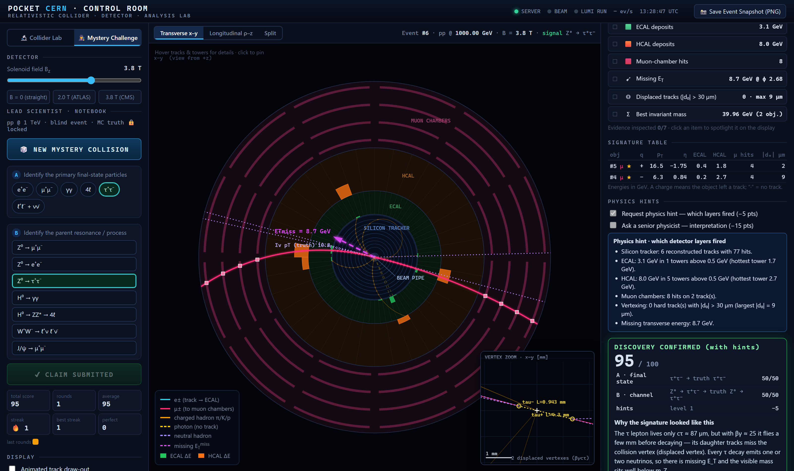

# Pocket CERN Collider

**A particle collider, detector and analysis lab that runs on your laptop.**
Collide e⁺e⁻ or pp beams at up to 1 TeV and watch every particle curl through a 3.8 T
ATLAS/CMS-style detector. Accumulate luminosity until a resonance peak rises out of the
background at 5σ. Then switch to the **Mystery Event Challenge**: read a blind event the way
an experimental physicist does and claim the discovery yourself.



<p align="center"><i>Collider Lab: a 3,000-event H → ZZ* → 4ℓ run on the ZZ continuum, shown in split
transverse (x–y) / longitudinal (ρ–z) view. The Voigt fit sits at 125 GeV; proton remnants escape
down the beam pipe; the MC truth panel lists the decay tree.</i></p>



<p align="center"><i>Mystery Challenge: a blind event with particle IDs withheld, solved as Z⁰ → τ⁺τ⁻.
After the claim, the display reveals the neutrino vectors, the τ decay vertices (0.94 mm and 4.25 mm
from the collision point) and an explanation of why the event looked the way it did.</i></p>

---

## Highlights

- **Exact relativistic kinematics.** Every event conserves 4-momentum to better than
  10⁻¹² GeV, with masses and widths taken live from the PDG via Scikit-HEP's `particle` package.
- **A real detector model.** Larmor helices in an axial field, 13 silicon layers, ECAL and HCAL
  towers, four muon stations, curvature (1/p_T) smearing, calorimeter resolution, and missing
  transverse energy E_T^miss from escaping neutrinos.
- **A statistical discovery engine.** Voigt (Breit–Wigner ⊗ Gaussian), relativistic
  Breit–Wigner, Lorentzian or Gaussian peaks fitted on an exponential continuum. It reports
  M ± σ_M, Γ, S/√B and the Asimov significance Z_A.
- **A control room in the browser.** One self-contained HTML file with no build step and no
  JavaScript dependencies. HiDPI canvases with zoom, pan and hover tooltips, animated track
  draw-out, a vertex inset at millimetre scale, a live histogram, a "5σ DISCOVERY!" banner,
  and PNG snapshots.
- **A teaching game.** Seven blind channels, an evidence spotlight, paid physics hints,
  partial credit with the reason for it, streaks, and a full MC-truth reveal after each claim.

## Quickstart

Requires Python 3.12 and [`uv`](https://docs.astral.sh/uv/).

```bash
git clone https://github.com/<you>/pocket-cern-collider.git && cd pocket-cern-collider
uv venv --python 3.12 && uv pip install -r requirements.txt
.venv/Scripts/python -m pytest && .venv/Scripts/python app.py     # macOS/Linux: .venv/bin/python
```

Then open **http://127.0.0.1:8000**.

Every module also has a terminal self-test: `python physics_engine.py`, `python detector_sim.py`,
`python invariance_lab.py`.

| Key | Action | | Key | Action |
|---|---|---|---|---|
| `Space` | fire one collision | | `V` | cycle x–y / ρ–z / split view |
| `L` | start or stop a luminosity run | | `T` | reveal MC truth (Lab mode) |
| `N` | new mystery event | | wheel / drag / double-click | zoom / pan / reset |

You can bookmark a view with URL options, for example
`/?channel=h_zz_4l&view=split&truth=1&lumi=1&sf=0.25` or `/?beam=ee&channel=z_tautau&b=0`.

---

## Architecture

The source lives in four modules, and each depends only on the ones before it:

```
physics_engine.py  ──►  detector_sim.py  ──►  invariance_lab.py  ──►  app.py + static/index.html
  truth events            what the detector      reconstruction, fits,     FastAPI JSON API +
  (GeV, mm)               sees (m, smeared)      Mystery game              control-room UI
```

| Module | Responsibility |
|---|---|
| `physics_engine.py` | PDG lookup, `FourVector`, Lorentz boosts, Breit–Wigner sampling, 2- and 3-body decays, displaced vertices, e⁺e⁻/pp beams (√s from 2 to 1000 GeV, optional asymmetric β_z), signal channels and continuum backgrounds |
| `detector_sim.py` | Cylindrical detector geometry, helix propagation, stopping rules per particle type, resolution smearing, particle-flow objects, E_T^miss |
| `invariance_lab.py` | M_inv candidates (ℓℓ, γγ, 4ℓ), histograms, `curve_fit` resonance fits, `LuminosityRun`, `MysteryChallenge` with clue-only reference solver |
| `app.py` | FastAPI server with strict JSON (non-finite → `null`) and bounded server-side state for luminosity runs, mystery events and player scores |
| `static/index.html` | The whole UI: canvas event display, telemetry, live histogram, Mystery notebook, PNG export |

## The physics

### Event generation (`physics_engine.py`)

- **Units and conventions.** Natural units (GeV, c = ħ = 1), metric (+,−,−,−), beam along ẑ.
  Every mass, width, charge and cτ comes from the live PDG tables in `particle`, converted
  from MeV to GeV.
- **Exact conservation by closure.** In every decay the last daughter is defined as
  parent − Σ(other daughters). Sums use compensated `math.fsum`. Boosts use the stable form
  of Λ(β), with γ²/(1+γ) in the spatial block. Across all beam/channel combinations the worst
  residual |P_init − ΣP_final| is about 10⁻¹³ GeV, and electric charge is conserved exactly.
- **Resonance line shapes.** Masses are drawn from a truncated relativistic Breit–Wigner,
  dN/ds ∝ 1/((s − M²)² + M²Γ²), by inverting its arctan CDF. The pdf is normalised over m ≥ 0.
- **Decays.** Two-body decays have the Källén momentum in the rest frame, with isotropic,
  1+cos²θ or sin²θ angular distributions, followed by cascading boosts. Three-body phase
  space uses Dalitz rejection.
- **Displaced vertices.** Each decay vertex sits at r⃗ = (p⃗/m)·cτ·ξ with ξ ~ Exp(1),
  i.e. at a flight length of βγcτ. τ leptons fly millimetres; K⁰_S fly centimetres.
- **Beams.**
  - *e⁺e⁻:* an ISR photon carries off √s − M (radiative return). Continuum masses follow the
    QED radiator spectrum.
  - *pp:* the parton momentum fractions x₁, x₂ are solved exactly for the system mass at
    rapidity y, with a k_T kick. Soft underlying-event hadrons are added, and the two proton
    remnants come from an exact 2-body split of the leftover system.
- **Channels.**
  - *Signal:* J/ψ → μμ/ee; Z → μμ/ee/ττ; H → γγ; H → ZZ* → 4ℓ; W⁺W⁻ → ℓνℓν.
  - *Backgrounds:* Drell–Yan/QED ℓℓ, γγ continuum, ZZ(*) → 4ℓ.
  - τ, ρ, π⁰ and K⁰_S decay automatically, weighted by branching ratio.

### Detector (`detector_sim.py`)

| Layer | Radius [m] | What it does |
|---|---|---|
| Beam pipe | < 0.03 | — |
| Silicon tracker | 0.03 – 1.10 | 3 pixel + 10 strip layers; hits come from analytic helix–circle crossings |
| ECAL | 1.10 – 1.70 | 72 φ-towers; stops e± and γ |
| HCAL | 1.70 – 2.80 | 36 φ-towers; stops hadrons |
| Muon chambers | 2.80 – 4.50 | 4 stations; only muons reach them |

- **Helices.** A charged particle follows a Larmor helix of radius
  $R\,[\mathrm{m}] = p_T\,[\mathrm{GeV}] \,/\, (0.2998\,|q|\,B\,[\mathrm{T}])$.
  With B_z = 3.8 T, a positive charge bends clockwise viewed from +z. B can be set to 0 for
  dead-straight tracks. Loopers that never reach a layer curl up inside the tracker.
- **Tracker resolution.** The measured quantity is the curvature κ = q/p_T, smeared with
  σ(p_T)/p_T = 0.01 ⊕ 0.0005·p_T. A very stiff track can therefore come back with the wrong charge.
- **Calorimeter resolution.**
  σ(E)/E = 0.10/√E ⊕ 0.01 (ECAL) and 0.50/√E ⊕ 0.03 (HCAL). Muons deposit minimum-ionising
  energy: about 0.3 GeV in the ECAL and 1.5 GeV in the HCAL, with Landau-like fluctuations.
- **Missing transverse energy.** It is particle-flow style, E⃗_T^miss = −Σ p⃗_T(reconstructed objects).
  It points along the escaping neutrinos and closes exactly against the visible objects.
- **Acceptance.** |η| < 2.5. Anything more forward escapes down the beam pipe.

### Analysis and discovery (`invariance_lab.py`)

- **Invariant mass.** $M_{\mathrm{inv}} = \sqrt{(\sum E)^2 - |\sum \vec p\,|^2}$ over smeared
  objects. For 4ℓ, Z₁ is the opposite-sign same-flavour pair closest to m_Z.
- **Fit model.** The binned χ² fit (`scipy.optimize.curve_fit`) is a signal peak plus a
  continuum $b_0\,e^{b_1 t + b_2 t^2}$. The peak can be a Voigt profile, a relativistic
  Breit–Wigner, a Lorentzian or a Gaussian. Expected counts are integrated over each bin
  rather than sampled at its centre.
- **Significance.** Both measures are computed in the window M ± 2σ_eff:
  - the simple S/√B;
  - the Asimov significance of Cowan, Cranmer, Gross & Vitells (EPJ C 71 (2011) 1554),
    $Z_A = \sqrt{2\,[(s+b)\ln(1+s/b) - s]}$, which stays honest when s ≳ b.

  The UI declares a discovery when Z_A ≥ 5.

Verified results (pp at 1 TeV, B = 3.8 T):

| Run | Fitted mass | PDG | Other results |
|---|---|---|---|
| Z → ee + Drell–Yan, 2,000 events | 91.188 ± 0.095 GeV | 91.188 | Γ_fit = 3.05 ± 0.59 GeV |
| H → γγ + γγ continuum, 4,000 events | 125.12 ± 0.06 GeV | 125.13 | — |
| H → 4ℓ + ZZ, 1,000 events | 125.24 ± 0.07 GeV | 125.13 | — |
| Z → μμ + Drell–Yan, 500 events | 91.24 ± 0.19 GeV | 91.19 | S/√B = 42 |

Detector mass resolutions: Z → μμ 1.26 GeV, Z → ee 1.02 GeV, H → γγ 1.36 GeV, H → 4ℓ 1.10 GeV,
J/ψ (e⁺e⁻ at 3.1 GeV) 20 MeV. All are unbiased.

## The Mystery Event Challenge

Each round is a blind pp collision at 1 TeV, drawn from seven channels:

- J/ψ → μμ
- Z → μμ, Z → ee, Z → ττ
- H → γγ, H → ZZ* → 4ℓ
- W⁺W⁻ → ℓνℓν

The server strips everything a real detector could not tell you: particle names, PDG IDs,
fates, invisible particles, truth decay vertices, and even the reconstructed object types.
Tracks are drawn in a single neutral colour, so you identify particles from their signatures.

1. **Inspect the evidence.** Click each item to spotlight it on the display: silicon tracks,
   ECAL and HCAL deposits, muon-chamber hits, E_T^miss, displaced tracks, and the best
   invariant mass. A signature table lists every object's charge, p_T, η, ECAL and HCAL energy,
   muon hits and transverse impact parameter |d₀|.
2. **Step A.** Choose the final state: e⁺e⁻, μ⁺μ⁻, γγ, 4ℓ, τ⁺τ⁻, or ℓ⁺ℓ⁻ + νν̄.
3. **Step B.** Choose the parent resonance or process.
4. **Submit your discovery claim.** It scores 50 + 50 points, with partial credit and the
   reason for it. For example, claiming W⁺W⁻ as Z → μμ earns 25 for the final state: you found
   the leptons but missed the neutrinos.

   Optional hints cost points: −5 for "which layers fired" and −15 for the senior physicist's
   interpretation. The reveal then replays the event with the MC truth decay tree, the neutrino
   vectors and the τ decay vertices, and explains why the event looked that way:
   - photons light the ECAL with no track;
   - muons reach the outer spectrometer;
   - τ daughters miss the vertex and bring E_T^miss.

   Your score, streak and best streak are kept on the server for each browser.

The τ evidence is measurable rather than taken from the truth. The displaced-track clue is
computed from helix geometry alone: |d₀| > 30 µm for tracks with p_T ≥ 2 GeV. It tags 62% of
Z → ττ events and gives no false tags on the prompt channels.

To show that every puzzle is solvable without MC truth, the test suite includes a rule-based
"junior physicist" that sees only the public clues. Across all seven channels it averages
**≈ 97/100**.

## HTTP API

| Method | Endpoint | Purpose |
|---|---|---|
| `GET` | `/api/config` | Beams, channels (PDG masses, thresholds, recommended √s), detector geometry, fit models, game metadata |
| `POST` | `/api/collide` | One collision. Returns polylines (x, y, z), hits, towers, objects, E_T^miss, M_inv vs truth, vertices, balance check, truth tree |
| `POST` | `/api/luminosity/step` | Advance a signal + background run by N events. Returns the histogram, the live fit (M ± σ_M, Γ, S/√B, Z_A, curves) and a representative event |
| `POST` | `/api/mystery/new` | A blind event plus raw evidence |
| `POST` | `/api/mystery/hint` | Hints at level 1 (layers) or level 2 (interpretation) |
| `POST` | `/api/mystery/guess` | Grade the claim. Returns the explanation, the full reveal and updated player stats |
| `GET` | `/api/mystery/stats` | Running score, streak and history |

Requests that are kinematically impossible (for example H → γγ at √s = 100 GeV) return
HTTP 422 with the physics reason. Interactive docs are at `/docs`.

## Testing

```bash
.venv/Scripts/python -m pytest        # 87 tests, ~25 s
```

The suite covers:
- Lorentz algebra, closure against independent boosts, Breit–Wigner normalisation, and
  conservation across every beam/channel combination;
- stopping rules per particle type, curvature sign for each sign of q and B, B = 0 straight
  tracks, resolutions, and E_T^miss alignment;
- fits on injected peaks and on Z + Drell–Yan runs;
- every API endpoint, including strict-JSON checks;
- a test that no truth leaks into blind events, for every mystery channel;
- the full game workflow: hints, penalties, streaks, and replayed verdicts;
- a **headless Chrome end-to-end test** that plays a full Mystery round against a live server.
  It is skipped if no Chrome or Edge is installed.

## Limitations

This is a teaching tool, not a physics generator:
- The detector is barrel only, with no endcap disks.
- Parton luminosities are power laws, not real PDFs.
- There is no hadronisation, jets, pile-up or material interactions (conversions,
  bremsstrahlung).
- Cross-sections are not modelled; the signal fraction is a slider.

The kinematics, conservation laws, field geometry and statistics are exact within this model.
